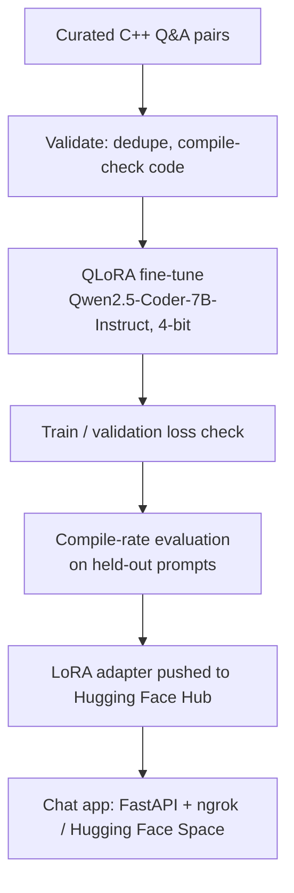

# CppBuddy 💻

A C++ tutor chatbot built by fine-tuning **Qwen2.5-Coder-7B-Instruct** with **QLoRA**. It answers C++ concept questions and coding problems with a short explanation, a compilable code example, and a practical tip, and politely redirects questions that aren't about C++.

This project is an end-to-end fine-tuning pipeline: curating and validating training data, QLoRA training on a free Colab T4, diagnosing and fixing overfitting, evaluating with a compile-rate test, and deploying the result as a chat app.

> Adapter on the Hub: [`mohitsharma9761/my-cpp-chatbot`](https://huggingface.co/mohitsharma9761/my-cpp-chatbot)

<!-- Add a screenshot or GIF of the chat UI here -->

## Why this project

Most "fine-tuned chatbot" tutorials run a few cells and call it done. This project instead treats the data and the evaluation as first-class problems:

- **Data quality checks**, not just loading a JSON file: broken-line detection, duplicate removal, and compiling every C++ code sample in the training data before it's used.
- **Caught and fixed overfitting**: an early 5-epoch run drove validation loss up while training loss collapsed toward zero, a clear memorization signal. Re-running with 2 epochs fixed it.
- **A real, if modest, evaluation**: held-out prompts are checked for whether the generated C++ actually compiles, not just whether the answer reads well.

## How it works



1. **Data**: ~250 question/answer pairs covering C++ concepts (pointers, RAII, smart pointers, STL, templates, move semantics, undefined behavior), coding problems (palindrome checks, BFS/DFS, sorting, searching), and off-topic redirects. Every full C++ program embedded in an answer is checked with `g++ -std=c++20 -fsyntax-only` before training, and the answer is dropped if it doesn't compile.
2. **Fine-tuning**: QLoRA (4-bit NF4 quantization + LoRA adapters) on a single free Colab T4 GPU. Loss is computed only on the assistant's reply tokens, not the prompt.
3. **Evaluation**: training/validation loss tracked per epoch to catch overfitting, plus a compile-rate test on coding prompts that were not in the training set.
4. **Serving**: a chat web app (FastAPI backend, HTML/JS frontend) tunneled with ngrok for quick demos, with a Hugging Face Space planned for permanent hosting.

## Tech stack

| Purpose | Tool |
|---|---|
| Base model | Qwen2.5-Coder-7B-Instruct |
| Fine-tuning | PEFT (LoRA), bitsandbytes (4-bit QLoRA), Transformers `Trainer` |
| Data | Python, `datasets` |
| Serving | FastAPI, Uvicorn, pyngrok |
| Hosting (model) | Hugging Face Hub |
| Compute | Google Colab (T4 GPU) |

## Training details

- **Method**: QLoRA, 4-bit NF4 base model, LoRA r=16, alpha=32, dropout=0.05
- **LoRA target modules**: `q_proj`, `k_proj`, `v_proj`, `o_proj`, `gate_proj`, `up_proj`, `down_proj`
- **Epochs**: 2 (chosen after a 5-epoch run showed clear overfitting)
- **Learning rate**: 2e-4, effective batch size 4 (batch size 1, gradient accumulation 4)
- **Max sequence length**: 1024 tokens

| Epoch | Training loss | Validation loss |
|---|---|---|
| 1 | 0.839 | 0.973 |
| 2 | 0.431 | 1.061 |

For comparison, an earlier 5-epoch run drove training loss down to ~0.01, with the model echoing training answers verbatim, which is why 2 epochs was chosen instead.

## Evaluation

8 held-out coding prompts (not seen during training) were sent to the model, and every `cpp` code block in each answer was compiled with `g++ -std=c++20 -fsyntax-only`.

- **7 / 8 code blocks compiled**
- **0 / 8 answers were missing a code block entirely**

This is a syntax/type check, not a correctness check, and the sample size is small. A larger, base-model-compared evaluation is a planned next step (see below).

## Project structure

```
.
├── notebooks/
│   ├── finetune.ipynb        # data validation + QLoRA training + evaluation
│   ├── app.ipynb             # FastAPI chat app + ngrok tunnel
│   └── test.ipynb            # load the pushed adapter and test it standalone
├── data/
│   └── training_examples.jsonl
└── README.md
```

## Running it yourself

1. Open `notebooks/finetune.ipynb` in Google Colab with a T4 GPU runtime.
2. Upload the training data file(s) listed in the notebook's `DATA_FILES` setting.
3. Run the cells in order. The notebook validates the data, reports counts and rejects, trains, and prints the compile-rate evaluation.
4. Push the resulting adapter to your own Hugging Face repo (Step 9 of the notebook).
5. Open `notebooks/app.ipynb`, point `ADAPTER_ID` at your repo, and run it for a live demo link, or `notebooks/test.ipynb` for a quick no-server test.

## Limitations

- Training data is modest (~250 examples), so most of what fine-tuning changed is answer *style* and *scope* (explain → code → tip, and refusing off-topic questions), not the model's underlying C++ knowledge.
- Generated code can compile and still be logically wrong; always review and test it.
- Off-topic redirection isn't fully reliable, it was trained on a limited set of refusal examples.
- The current demo link requires an active Colab session (see Roadmap).

## Roadmap

- [ ] Compare compile rate against the plain (non-fine-tuned) base model
- [ ] Expand the held-out evaluation set to ~30 prompts, and add a correctness check (run the program, not just compile it)
- [ ] Permanent deployment on a Hugging Face Space (GPU)
- [ ] Grow the training set past 250 examples, with more coding problems and edge cases
- [ ] Add retrieval over the C++ Core Guidelines for citation-backed answers

## Model card

Full training and evaluation details are also on the Hugging Face model card: [`mohitsharma9761/my-cpp-chatbot`](https://huggingface.co/mohitsharma9761/my-cpp-chatbot)

## License

Apache-2.0 (matches the base model's license; verify on the [Qwen2.5-Coder-7B-Instruct](https://huggingface.co/Qwen/Qwen2.5-Coder-7B-Instruct) page)

## Acknowledgements

Built on [Qwen2.5-Coder-7B-Instruct](https://huggingface.co/Qwen/Qwen2.5-Coder-7B-Instruct) by the Qwen team.
